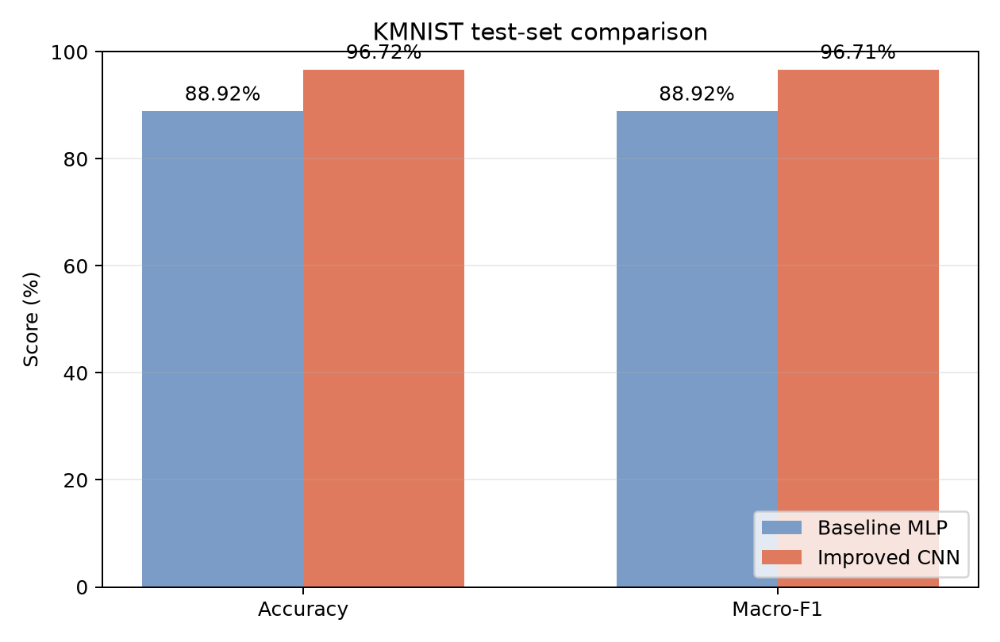
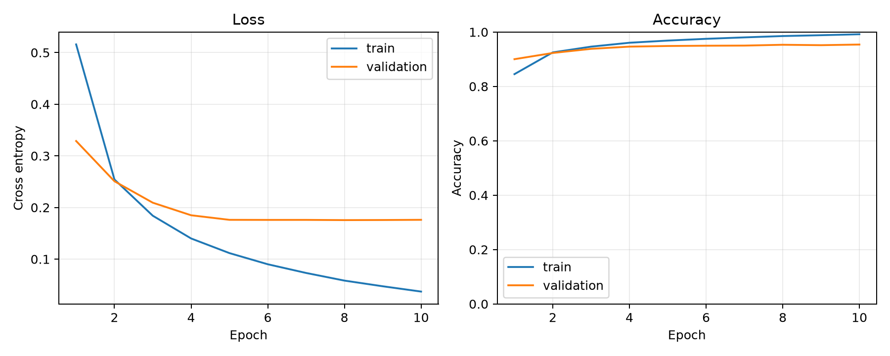
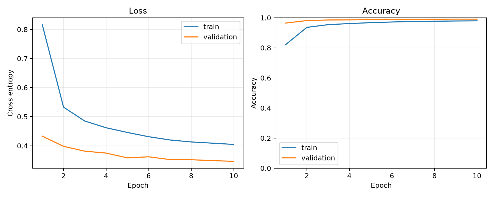
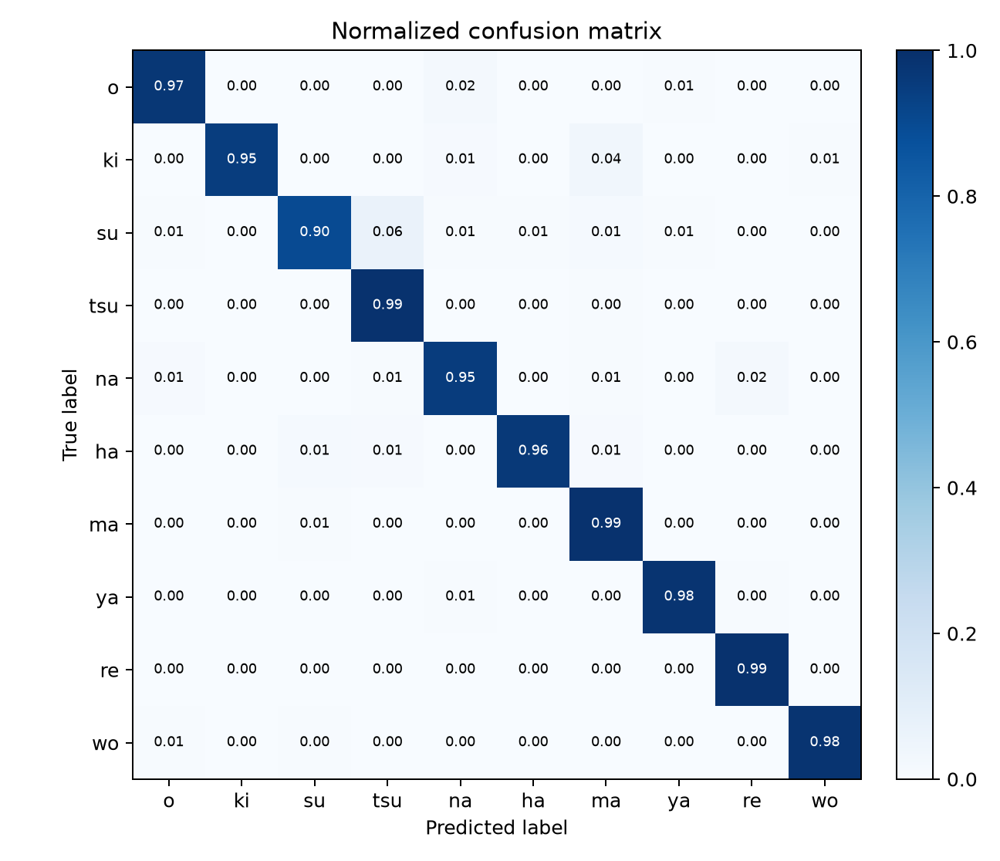
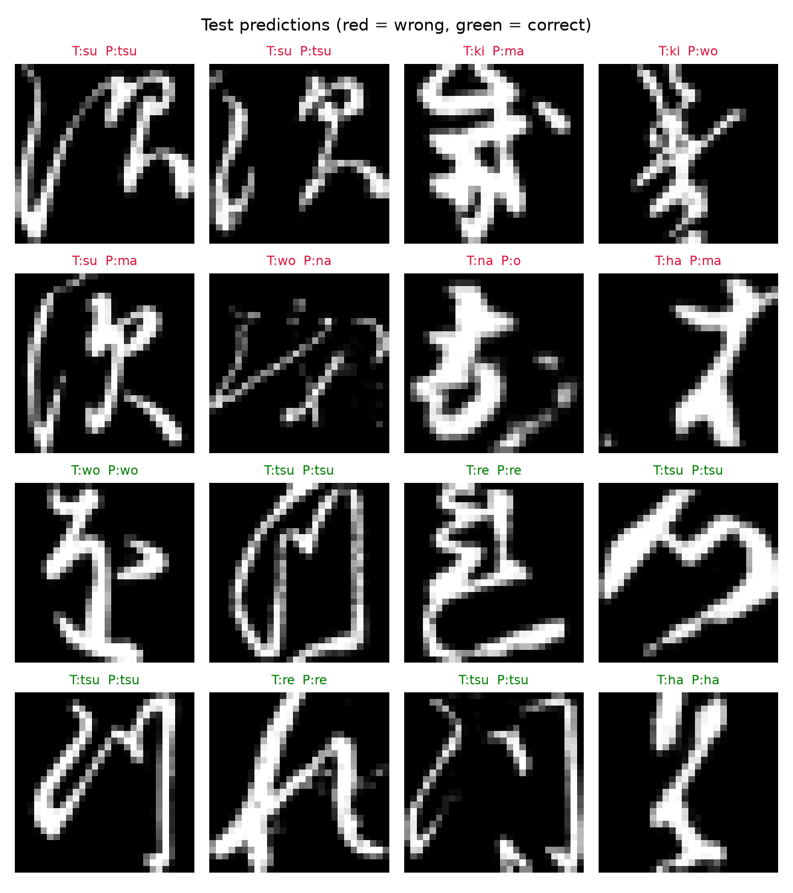

# 基于 KMNIST 的手写字符识别实验报告

## 1. GitHub 链接

项目代码地址：**【待补充 GitHub 链接】**

> 说明：后续把 `task5` 文件夹上传到自己的仓库后，将上面的占位内容替换成真实链接即可。

## 2. 任务描述

本次实验完成的是一个手写单字符识别任务，也可以看作 OCR 中比较基础的一步。模型的输入是一张 28×28 的灰度图片，输出是图片最可能属于的字符类别。这里识别的是 KMNIST 中的 10 个日文平假名草书字符，不涉及一整行文字的检测、字符切分和语义分析。

为了看出模型改进前后的差别，我做了两组实验。第一组使用简单的全连接神经网络作为基线，先把二维图片拉平成一维向量，再进行分类。第二组改成卷积神经网络，并加入 BatchNorm、Dropout、轻量数据增强和学习率调整。两组实验使用相同的数据划分、训练轮数和随机种子，最后在官方测试集上比较准确率与 Macro-F1。

我希望通过这次实验回答两个问题：一是简单的神经网络能不能完成基本的字符识别；二是在保留笔画空间关系以后，卷积网络能带来多大的提升。

## 3. 数据描述

### 3.1 数据集选择

实验使用 [KMNIST（Kuzushiji-MNIST）](https://codh.rois.ac.jp/kmnist/)。它来自日本古籍中的草书字符，格式和 MNIST 接近，但识别对象是真正的文字字符，比只识别 0～9 数字更符合这次文字图像识别的主题。数据集的[官方代码仓库](https://github.com/rois-codh/kmnist)提供了类别映射、基准结果和许可说明，本文通过 [Torchvision 的 KMNIST 接口](https://docs.pytorch.org/vision/main/generated/torchvision.datasets.KMNIST.html)下载和读取数据。

数据一共有 70,000 张 28×28 单通道灰度图，分成 10 个类别。其中训练集 60,000 张，每类 6,000 张；测试集 10,000 张，每类 1,000 张。数据集使用 CC BY-SA 4.0 许可，项目中只保存下载脚本和来源说明，不把原始数据提交到 GitHub。

| 标签 | 字符 | 罗马音 | 标签 | 字符 | 罗马音 |
|---:|:---:|:---:|---:|:---:|:---:|
| 0 | お | o | 5 | は | ha |
| 1 | き | ki | 6 | ま | ma |
| 2 | す | su | 7 | や | ya |
| 3 | つ | tsu | 8 | れ | re |
| 4 | な | na | 9 | を | wo |

### 3.2 数据划分和预处理

我从官方训练集中按类别均衡抽出 6,000 张作为验证集，剩下 54,000 张用于训练，官方的 10,000 张测试图只用于最后评价。划分时固定随机种子为 2026，因此两组实验拿到的是同一批训练图和验证图，比较会更公平。

所有图片先转成张量，再使用官方 60,000 张训练图（不包含测试集）的统计量进行归一化，均值为 0.1918，标准差为 0.3483。基线模型不做数据增强。改进模型在训练阶段加入不超过 8° 的随机旋转、8% 的平移和 0.92～1.08 倍缩放，让模型适应一些书写位置和大小变化。增强范围没有设得太大，因为字符的方向和笔画结构本身就是分类依据，过强变换反而可能改变字符特征。

## 4. 代码修改描述

这次没有拉取一个完整的开源识别项目，而是在原工程中新建了独立的 `task5` 目录。这样不会影响前面的植物分类、眼底分割等任务，数据、代码和实验结果也更容易单独整理。

主要新增内容如下：

| 文件 | 主要内容 |
|---|---|
| `models.py` | 实现基线 MLP 和改进 CNN，并提供统一的模型创建函数。 |
| `data_utils.py` | 下载 KMNIST，完成归一化、轻量增强、按类别均衡划分，以及外部图片预处理。 |
| `experiment_utils.py` | 封装每轮训练、测试指标、Macro-F1、混淆矩阵、训练曲线和预测样例绘制。 |
| `train.py` | 完成训练与验证，根据验证准确率保存最佳模型，最后在官方测试集上评价。 |
| `evaluate.py` | 读取保存的权重，独立复算测试集指标并重新生成混淆矩阵。 |
| `predict.py` | 支持输入一张自己的字符图片，输出概率最高的若干类别。 |
| `compare_results.py` | 自动读取两组 `metrics.json`，计算提升幅度并生成结果柱状图。 |
| `tests/` | 增加 9 个单元测试，检查模型输出、类别映射、数据划分、指标口径和图片预处理。 |
| `.gitignore` | 忽略原始数据、缓存和模型权重，避免把较大的可再生文件上传到仓库。 |

基线模型的结构是 `784 → 128 → 10`，使用 ReLU 激活和 Adam 优化器。这个模型很容易理解，参数也少，但图片在进入网络时被直接拉平了，原来相邻的笔画关系没有被明确利用。

改进模型使用两组卷积模块，通道数依次为 32 和 64。每个模块先连续执行两次 Conv-BatchNorm-ReLU，再进行最大池化和 Dropout，最后接 128 维全连接层输出 10 个类别。训练时使用 AdamW、余弦学习率衰减和 0.05 的标签平滑。卷积层可以从局部区域提取横、竖、弯钩等笔画信息，BatchNorm 让训练过程更稳定，Dropout 和数据增强主要用于减轻过拟合。

## 5. 实验设置

两组实验都训练 10 轮，batch size 为 256，初始学习率为 0.001，随机种子为 2026。损失函数使用交叉熵，模型按照验证集准确率保存最佳权重。运行环境如下：

- Python 3.14.6
- PyTorch 2.14.0 + CUDA 13.0
- NVIDIA GeForce RTX 4090 24 GB
- 训练集 54,000 张，验证集 6,000 张，测试集 10,000 张

训练时间只反映本次机器上的运行情况，不同显卡或使用 CPU 时会有明显差别。

## 6. 结果对比

### 6.1 总体结果

| 模型 | 参数量 | 最佳轮次 | 最佳验证准确率 | 测试准确率 | 测试 Macro-F1 | 训练时间 |
|---|---:|---:|---:|---:|---:|---:|
| 基线 MLP | 101,770 | 10 | 95.40% | 88.92% | 88.92% | 12.60 秒 |
| 改进 CNN | 468,010 | 9 | 99.08% | 96.72% | 96.71% | 17.35 秒 |



从结果来看，改进 CNN 的测试准确率从 88.92% 提升到 96.72%，增加了 **7.80 个百分点**；Macro-F1 增加了 **7.79 个百分点**。换成样本数来理解，10,000 张测试图中，正确数量由 8,892 张增加到 9,672 张，多识别正确 780 张。测试错误率从 11.08% 降到 3.28%，相对减少约 **70.40%**。

这次提升的代价也比较直观。改进模型的参数量约为基线的 4.60 倍，训练时间多了约 4.76 秒。不过整个模型仍然只有 468,010 个可训练参数，在当前显卡上训练 10 轮不到 20 秒。对这个课程实验来说，我认为增加的计算量是可以接受的。

### 6.2 训练过程

基线模型后几轮的训练准确率继续上升，最终达到 99% 左右，但验证准确率停在 95% 左右，训练损失与验证损失之间也出现了差距，说明模型存在一定过拟合。改进模型加入数据增强后训练样本变得更难，训练准确率反而没有基线高，但验证准确率达到了 99.08%。这说明训练集准确率高并不等于泛化能力强，也说明包含 CNN、数据增强和正则化在内的整体改进方案是有效的。由于本次没有另外做消融实验，暂时不能把提升单独归因于其中某一项改动。

| 基线 MLP | 改进 CNN |
|:---:|:---:|
|  |  |

随机划分的验证集成绩高于官方测试集成绩，尤其是基线模型差距更明显。一种可能的原因是验证图与训练图来自同一训练划分，样本分布更接近；官方测试集相对更独立，因此更能反映模型对新样本的识别能力。最终比较以官方测试集成绩为准。

### 6.3 分类情况和错误分析

改进模型在 10 类上的 F1 都超过了 93%。其中 `ya`、`re`、`wo` 的 F1 大约为 98.45%、98.07% 和 98.50%，识别比较稳定；`su` 的 F1 为 93.20%，是 10 类中最低的一类。混淆矩阵显示，最常见的错误是把 `su` 识别成 `tsu`，一共有 63 张；其次是把 `ki` 识别成 `ma`，一共有 35 张。这些字符在草书写法中有相似的弯曲笔画，图片又只有 28×28，部分细节比较难区分。

| 归一化混淆矩阵 | 预测样例 |
|:---:|:---:|
|  |  |

## 7. 总结与不足

本次实验完成了从数据下载、模型训练到独立评估和单图预测的一套字符识别流程。结果说明，全连接网络已经能识别大部分字符，但拉平操作不便于模型直接利用二维邻域和局部笔画结构；换成 CNN 并加入适当的数据增强与正则化后，测试准确率提高到了 96.72%，错误率也明显下降。

目前的任务仍然有几个限制。第一，模型只能在已经裁剪好的单字符图片上工作，还不能直接处理包含多个字符的照片。第二，类别只有 KMNIST 提供的 10 类，不能识别常用汉字、英文字母或数字。第三，单图预测中的居中和缩放规则比较简单，如果输入图片背景复杂或字符没有分割好，结果可能下降。后续如果继续改进，可以增加字符检测与切分步骤，扩展到更多类别，也可以专门分析 `su`、`tsu` 等易混类别并尝试注意力机制。

## 8. 复现方法

在项目根目录执行：

```bash
python -m pip install -r task5/requirements.txt

python task5/train.py --model baseline --epochs 10 --seed 2026
python task5/train.py --model improved --epochs 10 --seed 2026
python task5/compare_results.py

pytest -q task5/tests
```

详细数值保存在 `task5/results/baseline/metrics.json`、`task5/results/improved/metrics.json` 和 `task5/results/comparison.json` 中。原始数据会在第一次训练时自动下载，因此不用手动准备数据文件。
